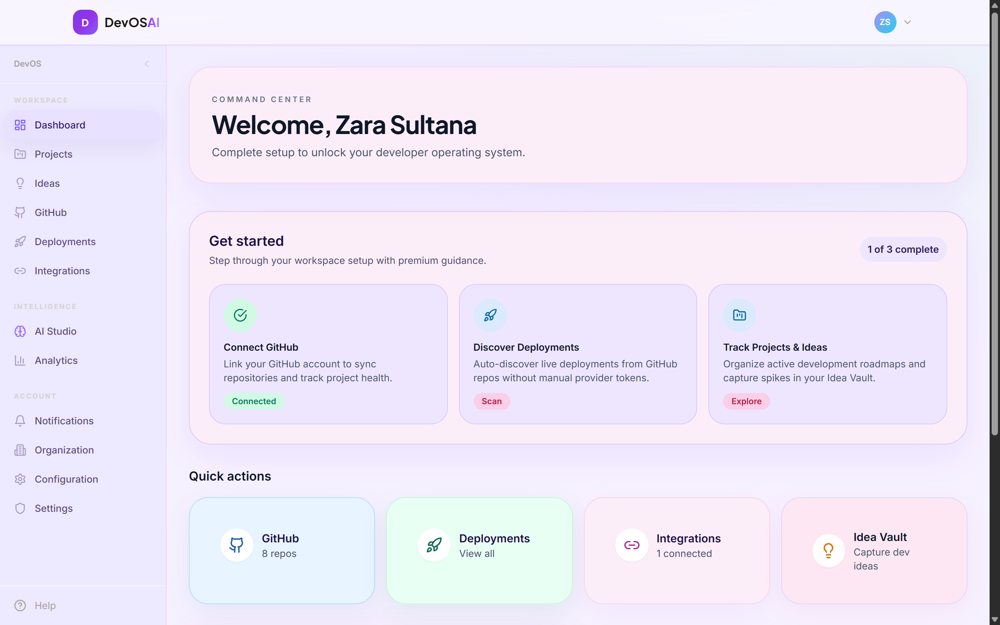
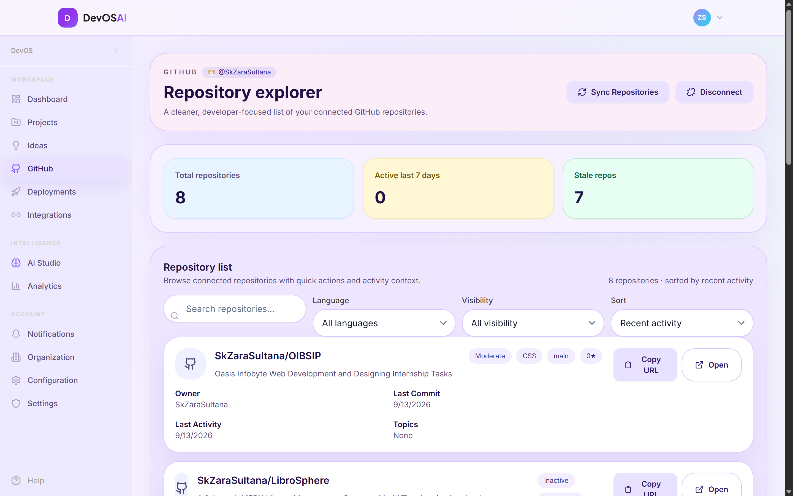
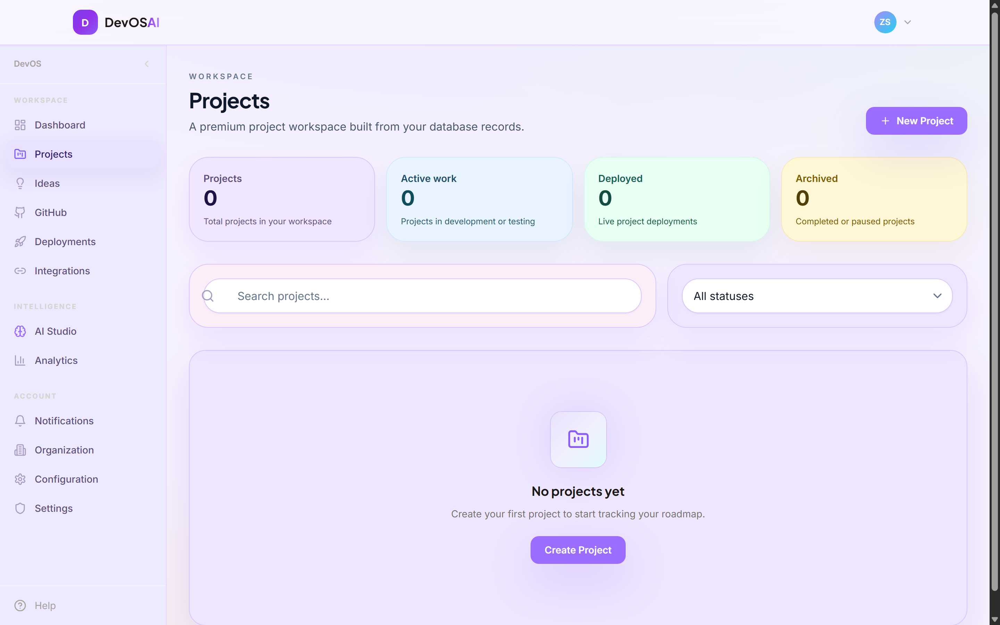
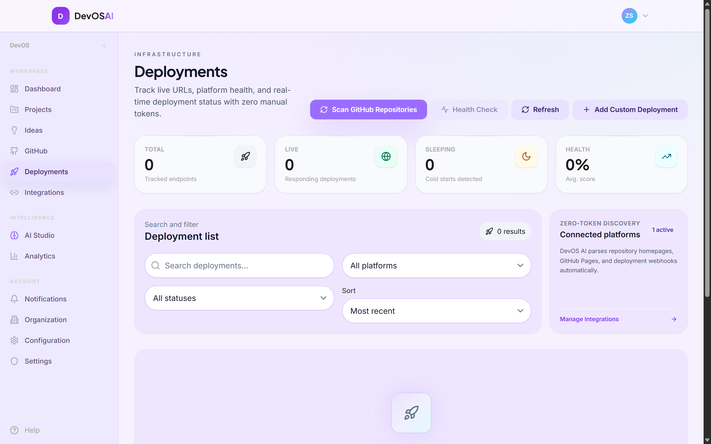
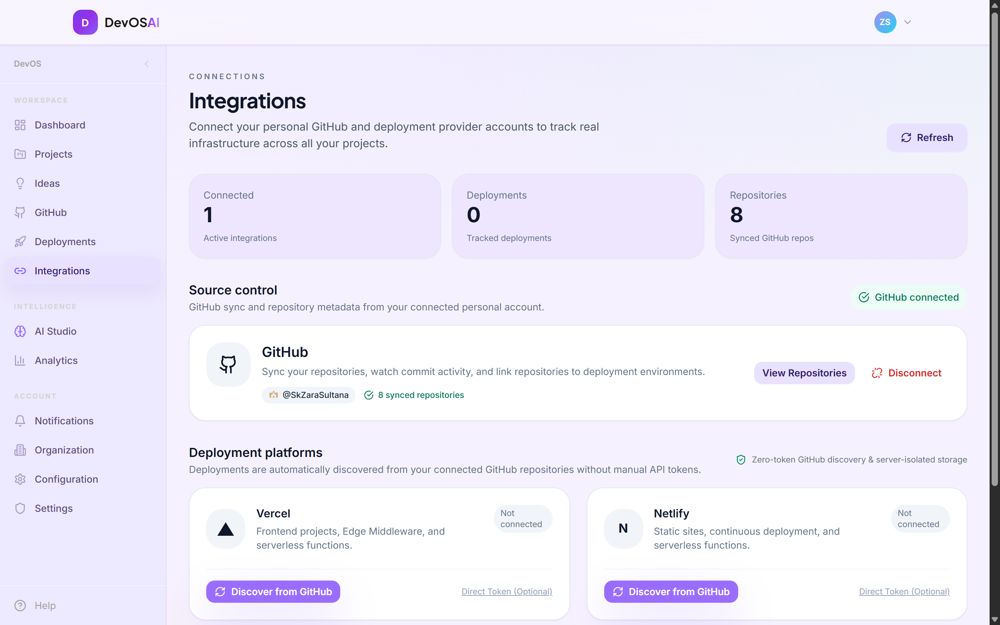

# DevOS-AI

> **An AI-powered Developer Operating System for unified GitHub repositories, deployment infrastructure tracking, and AI-assisted engineering.**

DevOS-AI centralizes developer workflows into a single dashboard. It connects your personal GitHub accounts, synchronizes repositories, tracks multi-cloud deployments (Vercel, Netlify, Render, Railway, AWS, Fly.io), and provides an integrated AI Studio for architecture planning, specification generation, and code scaffolding.

---

## Key Features

- **Multi-User GitHub Integration & Data Isolation**
  - Secure OAuth 2.0 flow with server-side token exchange and anti-replay state validation.
  - Strict multi-user data isolation backed by Supabase Row Level Security (RLS).
  - Account conflict detection preventing cross-account identity collisions while preserving existing user data.
  - Per-user repository synchronization and metadata tracking.

- **Centralized Infrastructure & Deployments**
  - Unified dashboard tracking deployments across Vercel, Netlify, Render, Railway, AWS Amplify, Heroku, and Fly.io.
  - Real-time deployment status monitoring, direct commit and environment links, and health checks.

- **DevOS AI Studio**
  - Generates technical specifications, architectural designs, API schemas, and starter code scaffolds.
  - Powered by high-speed LLM inference via **Groq** (`llama-3.3-70b-versatile` / `openai/gpt-oss-120b`) with **Google Gemini** fallback.
  - Interactive idea-to-spec pipeline with history tracking and direct backlog integration.

- **Idea Management & Backlog**
  - Capture, categorize, and prioritize project ideas with status tracking (`draft`, `in-progress`, `completed`).
  - One-click hand-off from backlog ideas directly into the AI Studio for specification generation.

- **Developer Analytics & Activity**
  - Commit velocity charts, language distribution breakdown, and deployment activity metrics using Recharts.
  - Comprehensive audit log of repository events, sync operations, and integration changes.

---

## Application Screenshots

### Command Center & Dashboard

*Centralized workspace command center with real-time metrics, quick actions, and setup status.*

---

### GitHub Integration & Repository Explorer

*Connected GitHub profile management, synchronized repository list, activity tracking, and multi-user isolation.*

---

### Projects Workspace

*Project tracking and active engineering roadmap management backed by database records.*

---

### Deployments & Cloud Infrastructure

*Zero-token deployment discovery, platform health monitoring, and multi-cloud environment tracking.*

---

### Provider Integrations

*OAuth and token-based connection hub for GitHub, Vercel, Netlify, Render, and Railway.*

---

## Tech Stack

| Layer | Technology |
| :--- | :--- |
| **Frontend Framework** | [React 18](https://react.dev/) + [TypeScript](https://www.typescriptlang.org/) |
| **Build Tool** | [Vite 5](https://vitejs.dev/) |
| **Styling & Design** | [Tailwind CSS](https://tailwindcss.com/) + [Lucide Icons](https://lucide.dev/) |
| **State & Data Fetching**| [TanStack React Query v5](https://tanstack.com/query/latest) |
| **Animations & UI** | [Framer Motion](https://www.framer.com/motion/) + [clsx](https://github.com/lukeed/clsx) + [tailwind-merge](https://github.com/dcastil/tailwind-merge) |
| **Visualizations** | [Recharts 3](https://recharts.org/) |
| **Backend & Database** | [Supabase](https://supabase.com/) (PostgreSQL 15, Auth, RLS Policies) |
| **Serverless Functions**| [Supabase Edge Functions](https://supabase.com/docs/guides/functions) (Deno runtime) |
| **AI Inference** | [Groq Cloud](https://groq.com/) & [Google Gemini](https://ai.google.dev/) |

---

## Project Structure

```text
devos-ai/
├── src/
│   ├── components/         # Reusable UI primitives, layout, and charts
│   ├── contexts/           # Authentication context and global providers
│   ├── hooks/              # Custom hooks and React Query mutations/queries
│   ├── lib/                # Supabase client, configuration, and helpers
│   ├── pages/              # Application pages (Dashboard, AI Studio, Ideas, GitHub, Deployments)
│   ├── services/           # GitHub OAuth, API, and AI client services
│   └── types/              # TypeScript database models and shared interfaces
├── supabase/
│   ├── functions/          # Deno Edge Functions (github-oauth, ai-generate, sync, etc.)
│   └── migrations/         # PostgreSQL schema migrations and RLS policies
├── public/                 # Static assets
├── .env.example            # Environment configuration template
├── package.json            # Project dependencies and npm scripts
└── vite.config.ts          # Vite build configuration
```

---

## Prerequisites

Before setting up DevOS-AI locally, ensure you have:

- **Node.js**: `v18.0.0` or higher
- **npm**: `v9.0.0` or higher
- **Supabase Account**: A Supabase project for Auth, PostgreSQL, and Edge Functions
- **GitHub OAuth App**: A GitHub OAuth application created under your GitHub account for repo integration
- **Supabase CLI** *(optional, for local Edge Function development)*: Install via `npm install -g supabase`

---

## Getting Started

### 1. Clone the Repository

```bash
git clone https://github.com/<your-username>/devos-ai.git
cd devos-ai
```

### 2. Install Dependencies

```bash
npm install
```

### 3. Configure Environment Variables

Copy `.env.example` to create your local `.env`:

```bash
cp .env.example .env
```

Open `.env` and fill in your values:

```env
# Supabase Client Configuration
VITE_SUPABASE_URL=https://your-project-ref.supabase.co
VITE_SUPABASE_ANON_KEY=your_supabase_anon_key

# GitHub OAuth Configuration
VITE_GITHUB_CLIENT_ID=your_github_oauth_client_id
VITE_GITHUB_REDIRECT_URI=http://localhost:5173/github/callback
```

> **Note:** Never commit `.env` or paste actual API secrets into version control. `.env` is ignored by `.gitignore`.

---

## Supabase & Backend Setup

### Database Migrations

Apply database migrations to your Supabase project in numerical order:

```bash
# Link your local project to Supabase
npx supabase link --project-ref your-project-ref

# Push database migrations
npx supabase db push
```

The migrations in `supabase/migrations/` configure:
- `users`, `integrations`, `repositories`, `deployments`, `ideas`, and `ai_history` tables.
- Comprehensive Row Level Security (RLS) policies ensuring strict user data isolation.
- Unique constraints preventing cross-account identity collisions.

### Supabase Edge Functions & Secrets

Deploy the backend functions and configure server-side secrets:

```bash
# Set secrets required by Edge Functions
npx supabase secrets set GITHUB_CLIENT_ID="your_github_client_id"
npx supabase secrets set GITHUB_CLIENT_SECRET="your_github_client_secret"
npx supabase secrets set GROQ_API_KEY="your_groq_api_key"
npx supabase secrets set GEMINI_API_KEY="your_gemini_api_key"

# Deploy Edge Functions
npx supabase functions deploy github-oauth --no-verify-jwt
npx supabase functions deploy sync-repositories
npx supabase functions deploy sync-deployments
npx supabase functions deploy ai-generate
npx supabase functions deploy check-provider-config
npx supabase functions deploy check-deployment-health
npx supabase functions deploy connect-provider
```

---

## Development & Verification

### Start Local Development Server

```bash
npm run dev
```

The application will start at `http://localhost:5173`.

### Run Verification Checks

Ensure all code formatting, types, and production builds pass without errors:

```bash
# 1. Type check TypeScript definitions
npm run typecheck

# 2. Run ESLint rules
npm run lint

# 3. Create production build
npm run build
```

---

## Security

- **Strict Client-Server Secret Separation**: Secrets such as `GITHUB_CLIENT_SECRET`, `SUPABASE_SERVICE_ROLE_KEY`, and AI provider API keys are exclusively accessed inside Supabase Edge Functions. The browser client only receives safe public keys.
- **Row Level Security (RLS)**: Every database table enforces RLS. Unauthenticated or cross-tenant queries are blocked at the database engine level.
- **Single-Use OAuth States**: OAuth state parameters are cryptographically randomized, bound to the user session, and invalidated upon consumption to mitigate CSRF and replay attacks.
- **Responsible Disclosure**: If you discover a security vulnerability, please open a private GitHub security advisory.

---

## License

This project is licensed under the MIT License.
